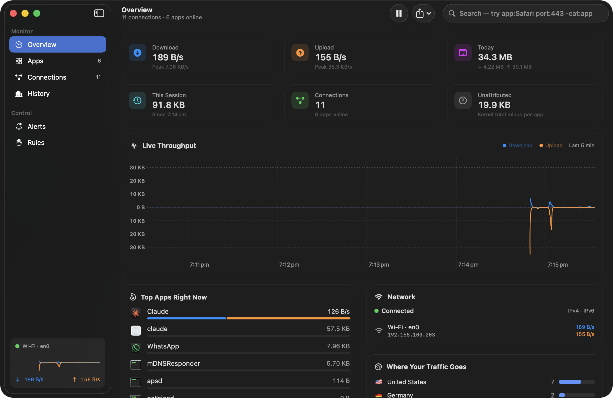
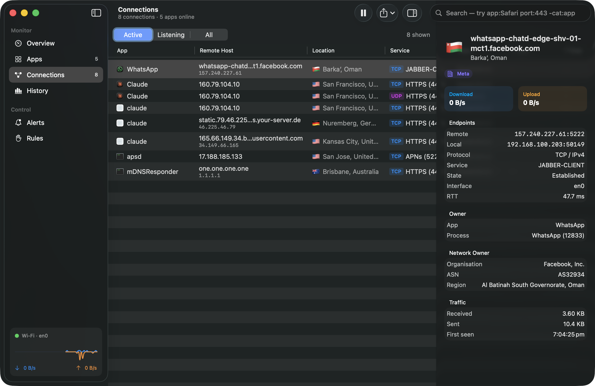
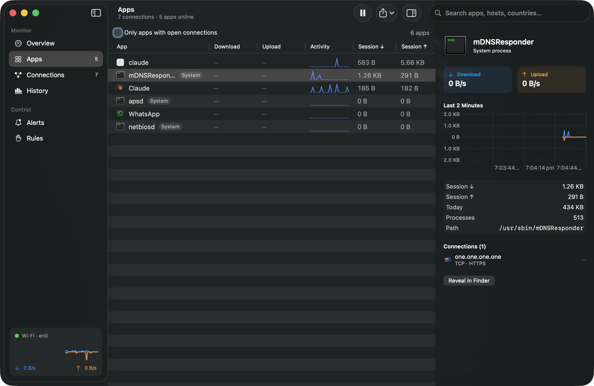
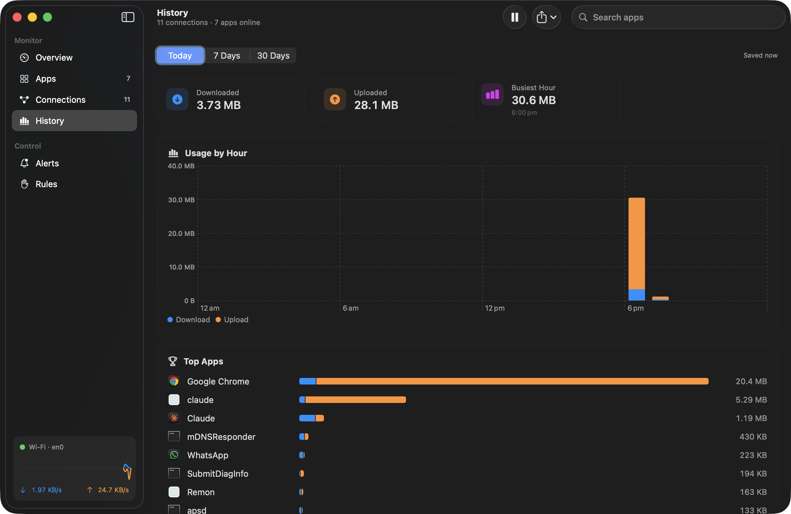
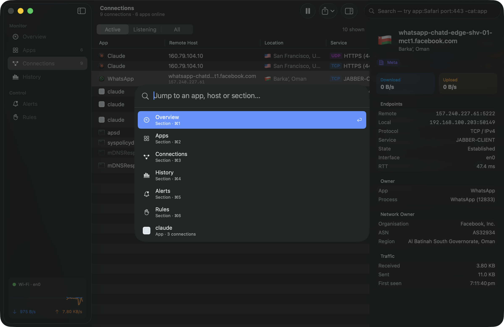
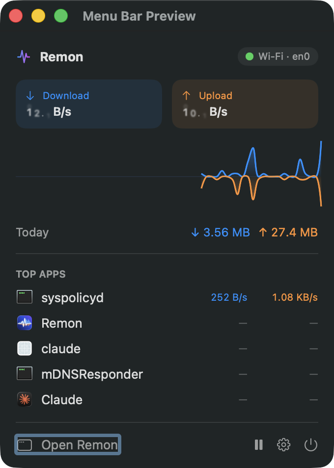
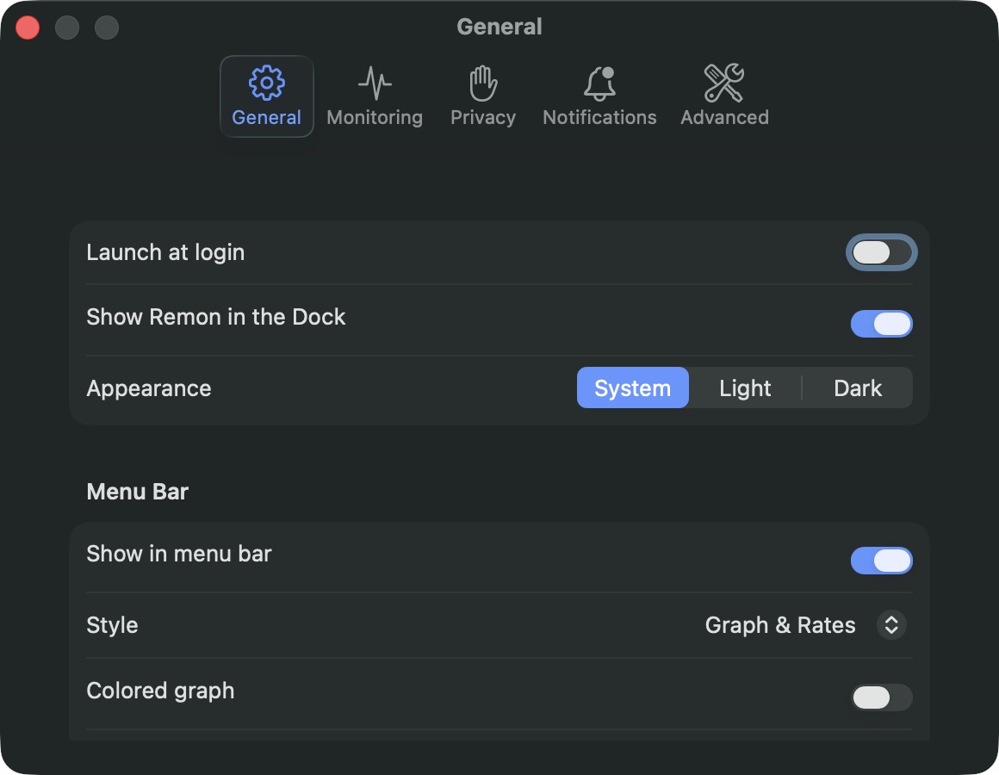

# Remon

A native macOS network monitor written in Swift and SwiftUI. It shows live per-app bandwidth, every open connection with its hostname, country and network owner, a world map of destinations, per-minute usage history, a searchable connection log, speed tests, data-plan tracking, alerts, and a live graph in the menu bar. It needs no system extension, root helper or third-party package.



| | |
|---|---|
|  |  |
|  |  |
|  |  |

All screenshots were captured from the running app on this Mac with real traffic. Nothing in them is mock data.

**Documents:** [docs/RESEARCH.md](docs/RESEARCH.md) is the competitive research (Little Snitch, LuLu, Radio Silence, TripMode, iStat Menus and others). [docs/SPEC.md](docs/SPEC.md) is the feature spec, split into Core and Premium polish.

---

## Build and run

Requirements: Xcode 26 or later (built here with Xcode 26.3 / Swift 6.2 on macOS 26.0.1). The deployment target is macOS 15.0.

```bash
open Remon.xcodeproj        # then ⌘R
```

From the command line:

```bash
xcodebuild -project Remon.xcodeproj -scheme Remon -configuration Release -derivedDataPath build/DerivedData build
open build/DerivedData/Build/Products/Release/Remon.app
```

```bash
xcodebuild -project Remon.xcodeproj -scheme Remon -derivedDataPath build/DerivedData test   # 26 tests (Swift Testing)
```

The app is ad-hoc signed ("Sign to Run Locally") with Hardened Runtime, and the **App Sandbox is off** (see the limitations section for why). If `xcodebuild` fails with "failed to load a required plug-in", run `xcodebuild -runFirstLaunch` once. That was needed on this machine.

### Launch arguments (demos and screenshots)

| Argument | Effect |
|---|---|
| `-initialSection connections` | Open on a section: overview, apps, connections, map, history, log, speed test, alerts or rules |
| `-skipOnboarding YES` | Don't show the welcome sheet |
| `-selectTop YES` | Auto-select the top app/connection so the inspector is populated |
| `-quickOpen YES` / `-openSettings YES` / `-previewMenuPanel YES` | Open Quick Open, Settings, or the menu bar panel in a window |

`scripts/screenshot.sh <section> <out.png> [wait] [window-title] [args…]` uses these to regenerate the screenshots. `scripts/make-icon.swift` renders the app icon.

---

## What's implemented

### Data sources (all real and live)
| What | How |
|---|---|
| Per-process and per-socket bytes, TCP state, RTT and interface, for **all** processes including root daemons, without root | `/usr/bin/nettop -L 0 -x -n` streamed through a **pseudo-terminal** and parsed incrementally ([NettopParser.swift](Remon/Core/NettopParser.swift), [TrafficSource.swift](Remon/Core/TrafficSource.swift)) |
| Whole-machine throughput, per interface | Exact 64-bit counters from the interface MIB, `sysctl net.link.generic.ifdata` ([InterfaceCounters.swift](Remon/Core/InterfaceCounters.swift)) |
| Connectivity, interface type, expensive / Low Data Mode | `NWPathMonitor` |
| PID → app name, bundle, icon; helpers folded into their parent `.app` | `proc_pidpath`, `Bundle`, `NSWorkspace` |
| Reverse DNS | `getnameinfo(NI_NAMEREQD)`, cached |
| Country, city, ASN and organisation | `https://ipwho.is` (opt-out). Rate-limited, backs off on HTTP 429, cached in SQLite for 30 days. Private, link-local, CGNAT, loopback and multicast addresses are classified locally and never sent |
| History | SQLite (system `libsqlite3`) at `~/Library/Application Support/Remon/history.sqlite`: per-app and total bytes per minute, a known-apps table, and the geo cache |

### Core features (spec Part A)
- **Apps:** a sortable table of live download/upload, sparkline, session totals and connection count. The inspector shows a 2-minute chart, today's usage, PIDs, path, open connections, Reveal in Finder and Quit.
- **Connections:**
  - Active / Listening / All filter, with protocol (TCP/UDP/QUIC) and service name.
  - Hostname with IP, flag and city, state, per-socket rates, total and RTT.
  - Closed sockets stay dimmed for 8 s.
  - The inspector shows endpoints, owner, ASN/organisation and a destination category.
  - Context menu: copy, filter by host, look up on ipinfo.io.
- **Overview:**
  - live rates and peaks
  - today and this-session totals
  - an **Unattributed** tile (kernel total minus the per-app sum)
  - a 5-minute mirrored throughput chart with hover
  - top apps right now
  - network status and interfaces
  - destinations by country
- **History:** Today (hourly) / 7 days / 30 days stacked bar charts with hover, summary tiles and top apps for the range.
- **Alerts:**
  - Four rule types: total rate, app rate, daily budget, and first-time app.
  - Sustain duration and cooldown on each rule.
  - A silent 60-second learning period on first run.
  - An in-app alert log and `UNUserNotificationCenter` delivery.
- **Rules (firewall):** a UI with persistence, behind a stub enforcer (see below).

### Premium features added in v1.1 (spec Part C)
- **Code-signature provenance:** each app shows Apple / App Store / Developer ID / Development / Ad-hoc / Unsigned / Invalid, plus its Team ID. It's a static `SecStaticCode` check with resource re-hashing skipped, so Chrome-sized bundles verify in milliseconds. Apps has an "Only unsigned or ad-hoc" filter.
- **World map:**
  - Every located destination is plotted with MapKit, with bubbles sized by data and geodesic arcs drawn from this Mac's public location.
  - A side panel lists locations with their apps and hosts; selecting one flies the camera to it.
  - The map respects the search filter.
- **Connection log:**
  - Every connection is written to SQLite when it closes, and still-open connections are written when you quit.
  - A searchable table over the last hour, 24 hours, 7 days or all time shows app, destination, location, port, category, duration and data.
  - It can be exported to CSV.
- **Speed test:** runs Apple's built-in `networkQuality` (no third-party servers) and reports download, upload, responsiveness (RPM) and idle latency. It has an animated gauge, a history chart and a list of past results, saved in SQLite.
- **Public IP and VPN:** your public IP, ISP and location (from ipwho.is, behind the same privacy toggle), and VPN tunnel detection. Alerts fire when the IP changes and when a VPN comes up or drops.
- **Monthly data plan:**
  - Set a limit, the reset day of the month, and whether uploads count.
  - Shows a usage ring, cycle dates, days left and a projected end-of-cycle total on Overview, and a progress bar in the menu bar panel.
  - Alerts at 80% and 100%, each firing at most once per cycle.
- **Smarter alerts:**
  - **Unusual usage:** an app has used at least 3× its usual daily average, and at least 50 MB.
  - **Connectivity:** the Mac went offline or came back online.
  - **Public IP / VPN:** your public IP changed, or a VPN came up or dropped.
  - **Daily digest:** a summary notification at an hour you choose.
  - Clicking a notification opens Remon on the relevant app.
- **Wi-Fi details:** signal bars, RSSI, signal-to-noise, band, channel and transmit rate via CoreWLAN.
- **Per-app 7-day chart** in the Apps inspector.
- **Floating monitor (⌥⌘M):** an always-on-top, draggable mini window with rates, a 90-second graph and the busiest app.
- **Shortcuts / Siri / Spotlight actions (App Intents):**
  - Get Network Throughput
  - Get Today's Data Usage
  - Get Busiest App
  - Pause or Resume Live Updates
  - Run Network Speed Test
- **Global shortcut ⌃⌥⌘R:** brings Remon up from anywhere. It uses the Carbon hotkey API, so no Accessibility permission is needed.
- **Color themes:** Classic, Ocean, Sunset, Forest and Graphite, applied live to every chart, the menu bar graph and the gauges.

### Premium polish (spec Part B)
- **Menu bar:**
  - The status item draws a live mirrored mini-graph and stacked ↓/↑ rates. It's a template image, so it matches the menu bar; a colored mode is available.
  - Four styles.
  - The popover has animated rates, a 60-second chart, today's totals, top 5 apps, Pause, Open, Settings and Quit.
- `NavigationSplitView` with sidebar badges and a live mini-graph footer, toolbar actions, native `Table`s with sorting and context menus, and `.inspector` panels.
- Swift Charts with Catmull-Rom areas, gradients, download/upload mirrored around zero, and hover callouts.
- **Search:**
  - `app:` `host:` `ip:` `port:` `proto:` `country:` `state:` `iface:` `pid:` `cat:` filters
  - quoted values and `-negation`
  - live suggestions
- **Quick Open (⌘K):** keyboard-driven, Spotlight-style.
- **Keyboard shortcuts:** ⌘1–⌘9 sections, ⌘K Quick Open, ⇧⌘P pause, ⌥⌘I inspector, ⌥⌘M floating monitor, ⌘R speed test (in Speed Test), ⌘E / ⇧⌘E export, ⌘0 main window, ⌘, settings, and ⌃⌥⌘R global.
- **Onboarding:** three pages, including an honest privacy disclosure and toggles, notification permission, launch at login and menu bar options.
- **Settings:** General, Monitoring, Privacy, Notifications and Advanced tabs. Covers launch at login (`SMAppService`), Dock icon, appearance override, menu bar style, bits/bytes, sample interval, helper grouping, loopback, retention, and clear/reveal data.
- **Export:** CSV and JSON for connections and app usage; CSV for history.
- **Destination labeling:** heuristics for Apple, Google, Microsoft, AWS, Cloudflare, Akamai, Fastly, Meta, CDN, Analytics/Telemetry, Advertising, Software Update and Local.
- **App icon:** generated by `scripts/make-icon.swift`. Dark mode follows the system.

---

## What's stubbed, and why

| Capability | Status | Why |
|---|---|---|
| **Blocking / allow-deny rules** (Little Snitch / LuLu style) | The UI and persistence work. Enforcement is behind the `ConnectionPolicyEnforcer` protocol, and this build ships `UnavailableNetworkExtensionEnforcer`, which reports the reason. The Rules screen says plainly **"Rules are not enforced in this build"**. | Blocking needs an `NEFilterDataProvider` **system extension**. That requires a Developer ID certificate, the `com.apple.developer.networking.networkextension` entitlement granted by Apple, notarization, and the user approving it in System Settings. None of that can be set up unattended or with ad-hoc signing. |
| Per-app data caps / metered-network blocking (TripMode) | Not implemented | Needs the same Network Extension. |
| Home-screen / Notification Center **widgets** | Not implemented | A WidgetKit extension needs an App Group shared with the app. App Group containers need a real Team ID (`group.<team>.…`), which an ad-hoc-signed build doesn't have. The App Intents above provide the same data to Shortcuts in the meantime. |
| Traffic source | Behind the `TrafficSource` protocol (`NettopTrafficSource`) | A Network Extension source could replace `nettop` later without UI changes. |

---

## Verification performed (and what wasn't)

**Verified on this Mac (macOS 26.0.1, Apple Silicon):**
- Debug and Release builds succeed with **zero compiler warnings** in Swift 6 language mode (strict concurrency).
- **18 unit tests pass:** nettop parsing (incl. IPv6, QUIC, column reordering), query language, address classification (16 cases), category heuristics, helper grouping, byte formatting, CSV/JSON export encoding, a SQLite round-trip, and live interface counters.
- The app was launched and screenshotted on every section. The data is real: dozens of live connections from Chrome, WhatsApp, Claude and system daemons, with hostnames and geolocation resolved. History persisted across restarts.
- I found and fixed these during verification:
  1. `nettop` buffers output to a pipe, so samples arrived in multi-second bursts. Fixed with a pty.
  2. `nettop` busy-looped at about 140% CPU when stdin was `/dev/null`. Fixed by giving it the pty as stdin.
  3. `getifaddrs`/`NET_RT_IFLIST2` counters are rounded to 1 KiB for unprivileged apps. Switched to the exact interface MIB.
  4. Charts animating every second cost 20–45% CPU. Animation is now opt-in, and **idle CPU is about 2–3% on most screens and 6–8% on the live Overview** (measured with `top`, Release build). `nettop` itself uses about 0%.
  5. The app didn't exit on SIGTERM, and on any quit path history was lost because main-actor tasks don't run during `terminateLater`. The flush is now synchronous.
  6. Orphaned `nettop` children were left after a force-kill. They are now reaped at launch.
- **Light mode and the appearance override:** [docs/screenshots/overview-light.png](docs/screenshots/overview-light.png) was captured with `-appearance Light` while the system was in dark mode.
- Quitting (⌘Q or SIGTERM) flushes history and leaves no `nettop` behind. After a SIGKILL, the orphan is cleaned up on next launch (tested).

**v1.1 premium features, verified on this Mac:**
- Debug build: zero compiler warnings. **26 tests pass.** The new tests cover billing-cycle maths (including year wrap and day clamping), anomaly thresholds, `networkQuality` JSON parsing, code-signature classification (an Apple system app and an unsigned file), and a connection-log SQLite round trip with search.
- Running app:
  - The connection log filled with real closed connections (29 within a couple of minutes, with hostnames, countries and categories).
  - Geolocation now stores coordinates for the map.
- A real `networkQuality -c` run returned exactly the fields the parser reads: `dl_throughput`, `ul_throughput`, `responsiveness`, `base_rtt` and `interface_name`.
- **Not screenshotted:** the Mac's screen locked partway through, and window capture doesn't work on a locked screen. I couldn't visually check:
  - Map, Log and Speed Test
  - the floating monitor
  - the data-plan card
  - the Wi-Fi row
  - signature badges

  The screenshots above predate v1.1. Regenerate them with `scripts/screenshot.sh map docs/screenshots/map.png 40` (and likewise for `log` and `speed test`).
- **Not verified:**
  - Shortcuts actions appearing in the Shortcuts app.
  - The global hotkey.
  - Notification click-through.
  - A full in-app speed test (only the CLI run above).
  - VPN and IP-change alerts, because no VPN was toggled.

**Not verified (I couldn't do these unattended):**
- **Notification delivery.** The permission prompt was never answered, so no banner was confirmed. Alerts were confirmed firing into the in-app log; the sidebar badge showed a "new app" alert.
- **Clicking the real status item** to open the popover. The popover's content was rendered and screenshotted in a window via `-previewMenuPanel`, and the status item itself was screenshotted in the menu bar.
- **Interactions that need a mouse or keyboard:** typing search queries in the UI, Quick Open arrow-key navigation, the export save panel, the alert rule editor, the Settings toggles, and **launch at login**. `SMAppService` registration may fail for an app run from DerivedData; the UI shows the error if so. The underlying logic (query language, CSV/JSON encoding) is unit-tested.
- **Running on macOS 15.** The deployment target is 15.0, but the app was only run on macOS 26.

---

## Known limitations

- **Not sandboxed, not App Store–eligible.** Spawning `nettop` and reading other processes' paths isn't possible in the App Sandbox. That's also why iStat Menus and Little Snitch ship outside the Mac App Store. Distribution would be Developer ID plus notarization.
- **`nettop`'s CSV output is not a stable API.** Apple could change the columns. The parser maps columns by header name and tolerates reordering, and failures surface as a banner while interface-level monitoring keeps running. A future Network Extension source can replace it.
- **Per-app numbers lag by one sample interval.** A frame is complete only when the next sample's header arrives. Whole-machine numbers from interface counters have no lag.
- **"Unattributed" traffic is real.** The kernel total includes traffic `nettop` doesn't attribute to a process: kernel/system traffic, sockets that opened and closed between samples, and protocol overhead.
- **Rate edge cases.**
  - The first sample of a newly seen connection counts all bytes since it opened.
  - Counters for a PID that disappears and comes back within 5 minutes are reconciled; after that, the first sample counts the PID's full cumulative bytes.
- **Geolocation uses a third-party free service** (ipwho.is) and sends public IPs to it. It's disclosed in onboarding, can be switched off, and is cached. If the service rate-limits or goes away, locations show "Internet" and Remon backs off for 5 minutes.
- **Destination categories are heuristics** based on PTR names and ASN owner names, not a curated database.
- **Pause** freezes the Apps and Connections tables for inspection. Charts, totals and history keep recording.
- **Changing** the sample interval, helper grouping or loopback setting restarts sampling and resets per-app session totals. Totals already written to history are kept.
- **Up to one minute of history can be lost** if the app is force-killed (SIGKILL) or crashes. Normal quits flush.
- **Speed tests use real bandwidth:** typically tens to hundreds of MB per run, against Apple's servers. On metered connections, run them sparingly.
- **Wi-Fi network name (SSID)** shows only if macOS has granted Remon Location access. Without it, CoreWLAN returns `nil` and the row says "Wi-Fi". Signal strength, channel and transmit rate don't need permission.
- **Anomaly detection** needs at least three previous days of history for an app before it can fire.
- **Icons:** command-line tools bundled as icon-less `.app`s (e.g. `claude`) show macOS's generic app icon.

---

## Project layout

```
Remon.xcodeproj           Xcode 16+ project (synchronized folders), shared scheme
Remon/
  App/RemonApp.swift      Scenes (main window, MenuBarExtra, Settings), AppDelegate, menu commands
  Core/                   Data layer — no SwiftUI except Classification colors
    NettopParser.swift      incremental CSV parser (pure, unit-tested)
    TrafficSource.swift     TrafficSource protocol + nettop/pty implementation + orphan reaper
    InterfaceCounters.swift exact interface MIB counters, addresses, interface kinds
    NetworkPathObserver.swift  NWPathMonitor wrapper
    ProcessResolver.swift   PID → AppIdentity (actor, cached)
    HostnameResolver.swift  reverse DNS (actor, cached)
    GeoLocator.swift        GeoLocating protocol, ipwho.is + offline implementations, IPClassifier
    HistoryStore.swift      SQLite actor
    PolicyEnforcer.swift    ConnectionPolicyEnforcer protocol + Network Extension stub + PolicyCenter
    Classification.swift    destination categories, port → service names
    CodeSignature.swift     static code-signature classification + cache
    SpeedTest.swift         networkQuality runner/parser
    NetworkEnvironment.swift public IP, VPN detection, Wi-Fi (CoreWLAN)
    Insights.swift          billing cycle and anomaly maths (pure, unit-tested)
    HotKey.swift            Carbon global hotkey
    SearchQuery.swift       query language
    Formatting.swift        byte/rate formatting
  Store/
    MonitorStore.swift      @MainActor @Observable central state: rates, aggregation, history buffering
    AlertCenter.swift       rules, evaluation, notifications
    Preferences.swift       UserDefaults-backed settings, launch at login
    ExportService.swift     CSV/JSON export
  Intents/RemonIntents.swift  App Intents + App Shortcuts
  Views/                  SwiftUI: MainView, Overview, Apps, Connections, Map, History, ConnectionLog,
                          SpeedTest, Alerts, Rules, QuickOpen, FloatingMonitor, Onboarding, Settings,
                          MenuBar, Components
RemonTests/               Swift Testing suite
docs/                     RESEARCH.md, SPEC.md, screenshots/
scripts/                  make-icon.swift, screenshot.sh, window-id.swift
```
